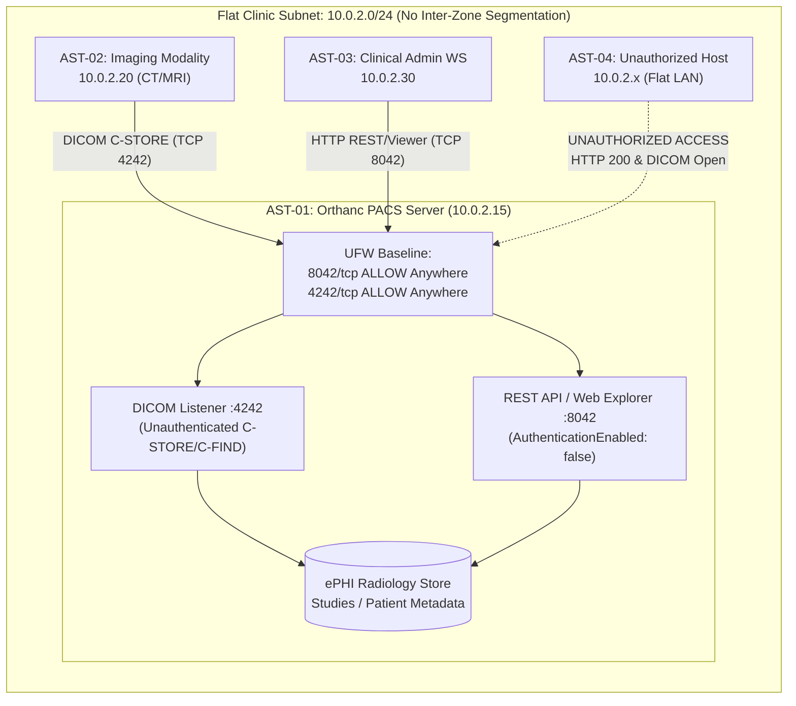

# Stage 3 — Imaging Architecture, Trust Boundaries & Data-Flow Map
**Engagement:** Case Study 01 — Northeast Radiology (NERAD)  
**Objective:** Map how ePHI enters, traverses, and exits the imaging environment and identify missing trust boundaries.

---

## 1. Baseline Trust-Boundary & Data-Flow Diagram (Flat Perimeter)
In the baseline state, all nodes share a single flat trust zone (`10.0.2.0/24`) with permissive host firewall rules (`ALLOW IN Anywhere`), allowing unauthorized lateral endpoints (`AST-04`) to cross directly into PACS storage and web interfaces:

---

## 2. Primary Imaging Data Flows & Dependencies
| Flow ID | Source | Destination | Protocol / Port | Payload / Sensitivity | Expected vs. Observed Trust Posture |
| :--- | :--- | :--- | :--- | :--- | :--- |
| `DF-01` | `AST-02` Modality (`10.0.2.20`) | `AST-01` PACS (`10.0.2.15`) | DICOM (`TCP 4242`) | Raw diagnostic images + patient demographics (**ePHI**) | **Expected:** Modality-only. **Observed:** Open to `Anywhere` (`0.0.0.0/0`). |
| `DF-02` | `AST-03` Clinical WS (`10.0.2.30`) | `AST-01` PACS (`10.0.2.15`) | HTTP REST (`TCP 8042`) | Study queries, administrative config, image retrieval (**ePHI**) | **Expected:** Authenticated clinical workstation only. **Observed:** Unauthenticated (`AuthenticationEnabled: false`) and open to `Anywhere`. |
| `DF-03` | `AST-04` Unauthorized (`10.0.2.x`) | `AST-01` PACS (`10.0.2.15`) | HTTP (`8042`) & DICOM (`4242`) | Full `/system`, `/patients`, `/studies` API enumeration | **Expected:** Blocked (`DROP`). **Observed:** Direct unauthenticated reachability across flat subnet. |
| `DF-04` | `AST-01` PACS (`10.0.2.15`) | `AST-05` Backup Target | Local / SMB / Rsync | Full PACS database & DICOM archive | **Dependency:** Single-host storage dependency; requires isolated offline/immutable copy to survive ransomware. |

---

## 3. Target Zero Trust Architecture (Post-Remediation Boundary)
To satisfy **NIST SP 800-207** and **NIST SP 1800-24**, `AST-01` enforces an explicit host-level **Policy Enforcement Point (PEP)** via UFW:
* `TCP 4242` accepts inbound DICOM associations **exclusively** from `10.0.2.20` (`AST-02`).
* `TCP 8042` accepts inbound administrative/viewer connections **exclusively** from `10.0.2.30` (`AST-03`).
* All other `10.0.2.0/24` hosts (`AST-04`) are silently dropped at the perimeter.
