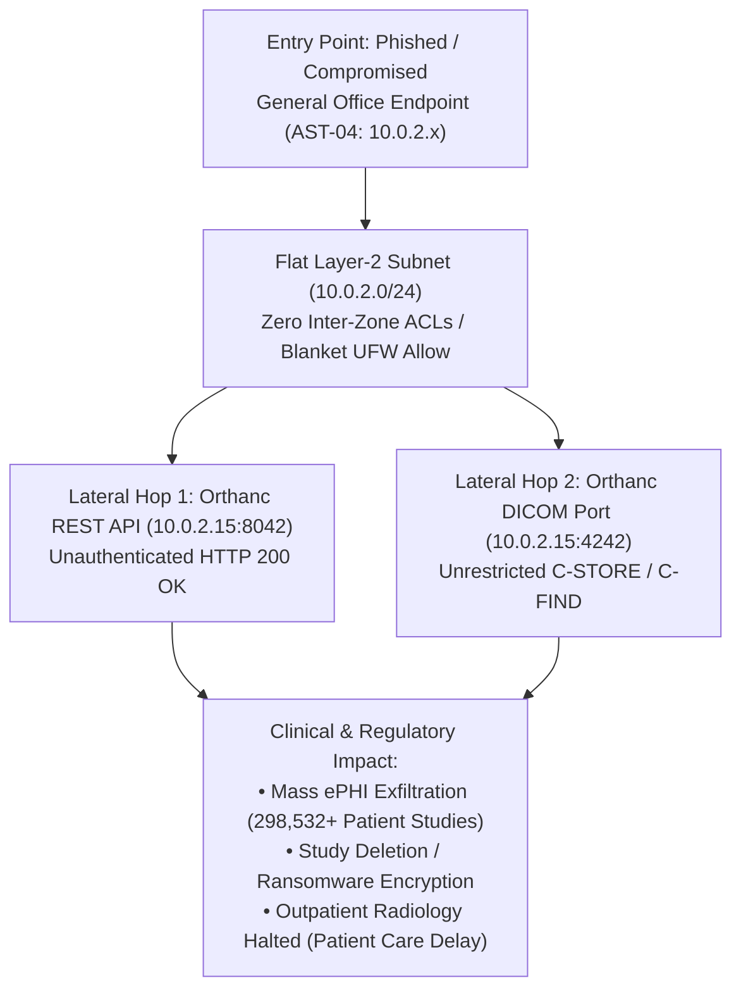

# Stage 5 — Imaging Network Exposure, Segmentation & Blast-Radius Analysis
**Engagement:** Case Study 01 — Northeast Radiology (NERAD)  
**Validation Pipeline:** `Observed → Confirmed → Reachable → Path established → Clinical/operational consequence established`

---

## 1. Confirmed Baseline Exposure Paths
1. **Unrestricted HTTP API & Web Explorer Exposure (`TCP 8042`):**
   * **Observed & Confirmed:** Baseline UFW policy permitted `8042/tcp ALLOW IN Anywhere` while `AuthenticationEnabled` was `false` (`E-003`).
   * **Reachable & Path Established:** Proved via `curl -i http://10.0.2.15:8042/system` returning `HTTP/1.1 200 OK` from an unauthorized subnet host (`AST-04`) (recorded in Case Study 01 walkthrough).
   * **Clinical Consequence:** Full unauthorized read/write/delete access to NERAD's diagnostic imaging repository (modeled on the real-world NERAD breach affecting 298,532 patients).
2. **Unrestricted DICOM Service Exposure (`TCP 4242`):**
   * **Observed & Confirmed:** Baseline UFW policy permitted `4242/tcp ALLOW IN Anywhere` (`E-001`).
   * **Reachable & Path Established:** Proved via `nc -zv 10.0.2.15 4242` returning `Connection to 10.0.2.15 4242 port [tcp/*] succeeded!`.
   * **Clinical Consequence:** Enables unauthorized DICOM study retrieval or malicious study injection into clinical reading queues, delaying radiologist diagnosis.

---

## 2. Blast-Radius Model (Compromised Office Workstation → PACS Crown Jewel)

---

## 3. Post-Remediation Policy Enforcement Point (PEP) Posture (`E-004`)
Following Zero Trust micro-segmentation (`NIST SP 800-207`), `AST-01` enforces host-level UFW default-deny inbound rules (`E-004`):
* `8042/tcp` permitted **only** from `10.0.2.30` (`AST-03` Clinical Admin Workstation).
* `4242/tcp` permitted **only** from `10.0.2.20` (`AST-02` Diagnostic Imaging Modality).
* All lateral probes from `AST-04` (`10.0.2.x`) are silently dropped (`DROP`), collapsing the lateral blast radius to zero.
